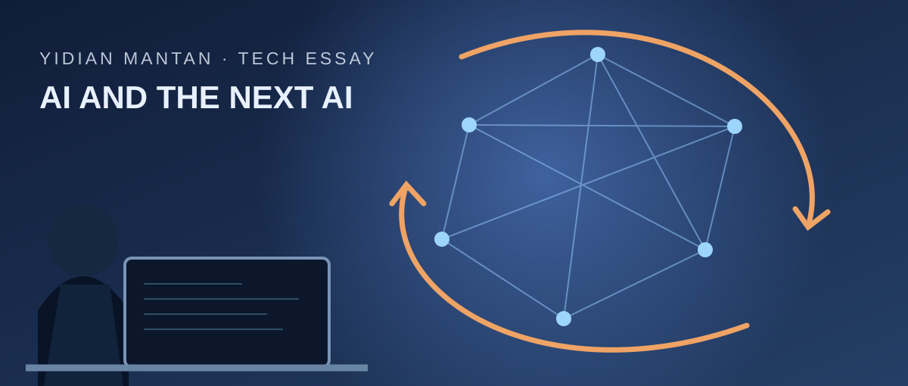
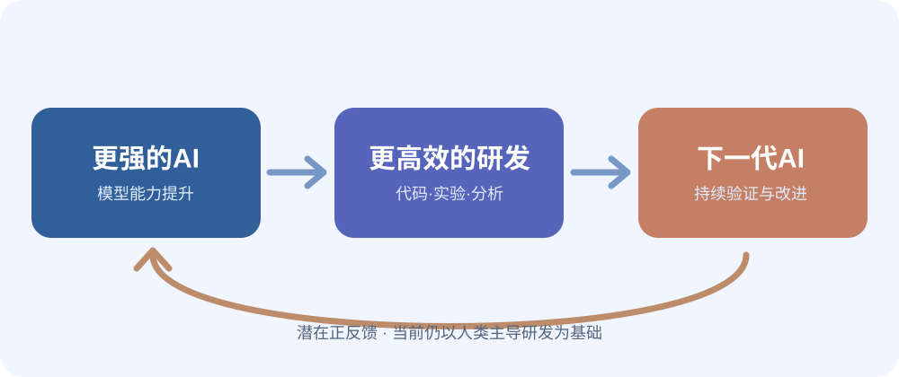
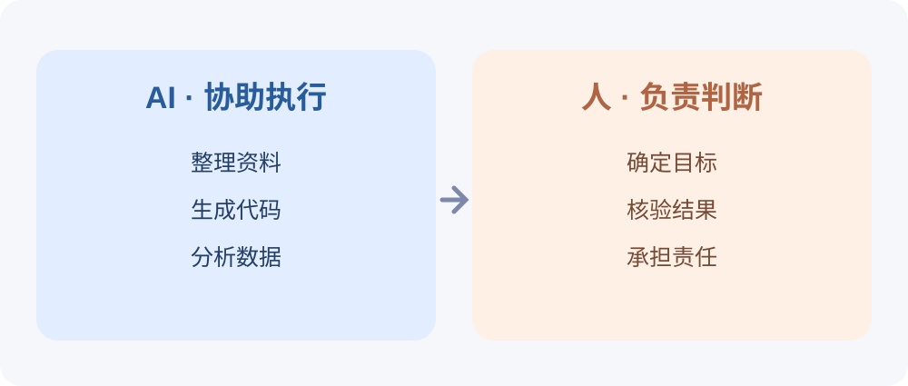

# AI开始帮人类开发下一代AI，真正的变化才刚刚开始

> 当AI不仅能写代码，还能帮助研究人员研发更强的AI，技术进步的方式可能正在改变。对于普通人来说，判断什么值得做，或许比追逐每一次模型更新更加重要。

*文 / 一点漫谈 · 2026年11月6日*

*封面：原创SVG概念插画，非真实实验室摄影。*

过去几年，我们已经习惯了人工智能不断变强。

从最初的聊天问答，到写代码、分析数据、检索资料，再到调用各种工具完成复杂任务。几乎每隔一段时间，我们就会听说某个模型刷新了纪录。

但有一个问题，比模型排行榜上的分数更值得思考：

**如果AI不仅帮助人类完成工作，还能帮助人类开发更强大的AI，会发生什么？**

11月5日发布的一项研究，让这个过去带有科幻色彩的问题有了新的现实依据。

它并没有证明AI已经能够独立创造下一代AI，却揭示了一种正在发生的变化：**人类发明的工具，开始参与改进工具自身的过程。**

## 01｜一项研究，发现了不寻常的加速

11月5日，独立AI研究机构METR发布了对Anthropic研发工作的评估报告。

研究团队花费约11周，接触了内部模型表现、研发资料和研究人员访谈等信息，试图回答一个问题：AI究竟在多大程度上加快了AI研发？

结果值得关注。

自2025年10月以来，Anthropic模型在特定能力基准上的进步速度，估计达到此前的**1.9倍**。

这并不是说模型的智能水平突然变成了原来的1.9倍，而是指研究所观察到的特定能力指标随时间改进的速度。

研究者认为，AI辅助编程、实验和其他研发活动，很可能解释了其中相当一部分加速。

不过，有三个限制不能忽略。

首先，1.9倍是一项带有不确定性的估计，而不是一个普遍适用于所有AI公司的规律。

其次，研究涉及内部数据和研究者判断，其结果不能简单推广至整个行业。

最后，研究并没有证明AI已经能在最关键的模型训练研发环节独立作出重大贡献。

**真正发生的，是人类研究者正在得到越来越强大的研发助手。**

这个区别非常重要：它让我们既不忽视技术进步，也不会过早地把未来想象成由机器完全主导。

## 02｜当工具开始改进工具

回顾过去几百年的技术史，大多数工具都在帮助人类更高效地完成某项工作。

蒸汽机扩大了人类利用动力的能力；计算机提升了计算与信息处理效率；互联网大幅降低了信息传播成本。

AI有一个特别值得关注的地方：**它能够参与某些创造新技术所必需的认知工作。**

以开发一个AI模型为例，研究人员需要设计实验、编写程序、处理数据、发现错误、分析结果，并决定下一轮应该尝试什么。

现在，AI可以协助编写实验代码、寻找软件缺陷、整理结果，甚至帮助提出值得测试的方案。

假设原来一个团队每天只能完成五轮有效实验，而在AI辅助下能够完成更多轮，那么研发流程就可能加快。这里的“五轮”只是用来解释机制的假设，并非此次研究的实测数字。

更强的模型，又可能进一步提高这些辅助工具的能力。

于是，一个潜在的循环出现了：

*图1：原创示意图。描述可能的研发反馈机制，并不代表AI已经实现完全自主进化。*

这让人联想到“递归自我改进”。不过，**AI辅助人类研发**与**AI脱离人类持续自主改进自身**并不是一回事。

两者之间仍然隔着可靠性、实验验证、算力、工程组织和安全等一系列现实问题。

## 03｜真正的变化，是完成一件事所需的成本

对于大多数普通人来说，AI能否自己研发下一代模型，也许不是每天最关心的问题。

但同一种技术进步，已经开始改变我们做事的方式。

假设你是一名独立开发者，想开发一个面向小商家的预约系统。

过去，你可能需要自己编写登录模块、设计数据库、搭建后台管理页面、处理部署问题。即使只是一个最小可行产品，也可能消耗大量时间。

如今，AI可以帮助生成基础代码、解释错误、补充测试用例，甚至协助设计初步技术方案。

这并不意味着软件开发不再需要工程师。

因为系统是否安全、数据模型是否合理、业务流程是否符合真实需求，依然需要人来验证。

但有一点可能已经改变：**完成一个初步产品所需的时间和人力门槛正在下降。**

同样的变化，也可能出现在其他领域。

写作者能够更快地整理资料，但不能因此省略事实核查。

设计师能够迅速探索不同风格，但仍然需要审美判断。

经营者能够让AI分析订单数据，但最终仍要决定哪些业务值得投入。

过去阻碍一个人做成某件事的，可能是缺少执行资源。未来，阻碍他的可能更经常是另一个问题：**他是否知道自己究竟要解决什么？**

## 04｜为什么AI越强，判断力反而可能越重要

我们常常把技术能力理解成一种线性关系：工具越强，工作越简单，人就越不需要投入。

但现实未必如此。

当一项任务的执行成本降低，完成这项任务的人可能会越来越多。

生成一篇文章变得容易，并不意味着好文章会自动增多；开发一个应用变得容易，也不意味着市场上会出现更多真正解决问题的产品。

AI能够生成大量看起来合理的结果，却不一定理解那些没有写进提示词的现实约束。

一个自动生成的订单系统可以拥有完整界面，却可能忽略退款后如何进行财务冲正。

一份看起来专业的数据分析报告，可能因为指标定义错误而得出误导性的结论。

一篇语言流畅的科普文章，也可能引用根本不存在的研究。

**生成答案的能力，与判断答案是否可靠的能力，是两回事。**

*图2：原创示意图。AI可以辅助执行，人类仍需确定目标、核验结果并承担责任。*

当答案越来越便宜，验证答案可能成为新的工作重点。

这意味着，未来真正值得长期培养的能力，不只是使用某款AI工具，还包括理解问题、拆解任务、检查事实和承担决策责任。

## 05｜也许我们不必追逐每一次模型更新

对技术感兴趣的人，很容易陷入一种疲惫的循环。

这个月出现了新的模型，下个月发布了更强的编程工具，再过几周，又有新的Agent框架成为讨论热点。

每一项更新都像在提醒我们：如果不立刻学习，就可能落后。

但对于绝大多数人来说，没有必要掌握所有工具。

更实际的方式，是从自己的真实工作出发。

找到那些经常重复、耗费时间、规则相对明确，而且结果容易验证的任务。

先尝试让AI承担其中一小部分，再观察是否真的提高了效率。

如果有效，就把方法固定下来；如果效果不稳定，就继续调整，或者保留人工处理。

与其每次都为模型性能提升几个百分点兴奋，不如认真计算：自己是否真的节省了时间，减少了错误，或者创造了过去无法创造的价值？

技术的意义，最终要回到真实生活中衡量。

## 写在最后

METR的研究，并不意味着AI已经跨过某个确定的临界点。

模型的研发速度是否会持续加快？加速能否从特定测试任务扩展到真实世界？未来又会遇到哪些瓶颈？

这些问题还没有最终答案。

但一个趋势正在变得清晰：AI已经不只是人类使用的普通工具，它开始参与新工具的创造过程。

这可能成为未来技术发展中非常重要的一次变化。

而对普通人而言，我们或许也应该改变看待AI的方式。

不必把它当成无所不能的替代者，也不必把它当成必须追逐的排行榜。

更重要的是找到那些值得自己投入时间的问题，并学会利用越来越强大的工具解决它们。

> **未来最稀缺的，未必是做事的能力，而是知道什么事情值得去做。**

当AI能够完成越来越多的工作，你希望把节省下来的时间用来做什么？

欢迎在评论区聊聊你的想法。

*这里是「一点漫谈」，关注科技，也关注科技背后的人与生活。*

---

## 备选标题

1. **AI开始帮人类开发下一代AI，真正的变化才刚刚开始**（推荐）
2. 当AI开始改进AI，我们还需要学什么？
3. 一项最新研究发现：AI可能正在让自己进化得更快

## 事实来源

- [METR：Independent Assessment of AI R&D Acceleration at Anthropic in October 2026（2026-11-05）](https://metr.org/blog/2026-11-05-anthropic-ai-rd-acceleration-assessment/)
- [Reuters：Anthropic's models improving nearly twice as fast with help from AI, study finds（2026-11-05）](https://www.reuters.com/technology/anthropics-models-improving-nearly-twice-fast-with-help-ai-study-finds-2026-11-05/)

> 研究数字与事实陈述以原始研究及报道为依据；对个人职业、独立开发和工作方式的讨论属于作者分析。

## 图片来源与版权

- `cover.svg`：本次原创绘制的概念插画，并非真实实验室照片。
- `feedback.svg`：本次原创绘制的信息示意图。
- `roles.svg`：本次原创绘制的信息示意图。
- 三张图片均不含第三方摄影作品或商业字体文件。正式商业发布前仍应进行人工检查。
